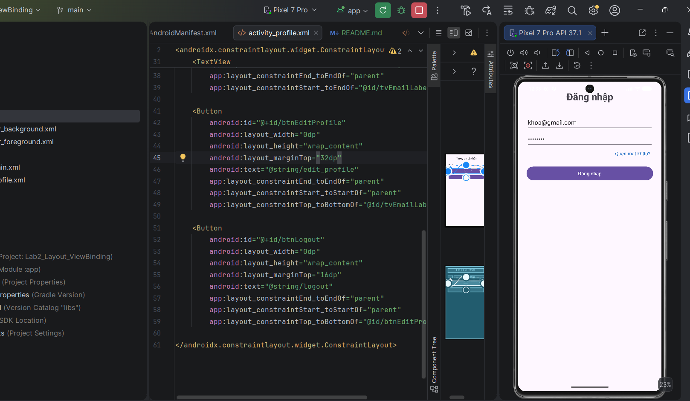

# LAB 02: Thiết kế giao diện phẳng XML & ViewBinding

**Họ và tên:** Nguyễn Nam Khoa
**MSSV:** 2474802010194
**Lớp / Chuyên ngành:** Công nghệ thông tin

---

## 📱 Giới thiệu ứng dụng
Ứng dụng gồm 2 màn hình chính:
1. **Màn hình Đăng nhập (`MainActivity`)**: Xây dựng bằng ConstraintLayout phẳng, tích hợp ViewBinding, hỗ trợ kiểm tra tính hợp lệ của dữ liệu (email, mật khẩu).
2. **Màn hình Hồ sơ người dùng (`ProfileActivity`)**: Hiển thị thông tin cá nhân và nhận dữ liệu Email truyền từ màn hình Đăng nhập qua Intent.

---

## 🛠 Tính năng đã hoàn thành
- [x] Bật ViewBinding trong `build.gradle.kts`.
- [x] Thiết kế giao diện phẳng không lồng nhau phức tạp bằng `ConstraintLayout`[cite: 1].
- [x] Quản lý chuỗi tài nguyên tập trung trong `strings.xml`, không hardcode chuỗi[cite: 1].
- [x] Hỗ trợ đa ngôn ngữ (Tiếng Việt & Tiếng Anh `values-en`).
- [x] Xử lý sự kiện bấm "Quên mật khẩu?" hiển thị Toast.
- [x] Validate Email & Mật khẩu (tối thiểu 6 ký tự)[cite: 1].
- [x] Chuyển màn hình và truyền dữ liệu bằng Intent[cite: 1].

---

## 📸 Hình ảnh minh chứng (Screenshots)
